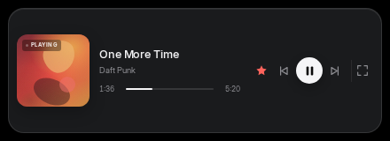

# Cirro Desktop

> 一个面向 Windows 的、非官方的 Cirro 桌面重制版。
> 当前阶段的重点是 **视觉语言与动效一致性**，不是功能对齐。

Cirro 原本是一个 Android 音乐播放器，设计上有很强的个人风格：品牌红、流体渐变、玻璃浮层、封面取色、胶囊形 dock、从卡片连续长成全屏播放页的动效，以及逐行/逐字歌词。这个项目把同一套语言搬到桌面，而不是把手机比例放大。


## 下载

- **Windows 10/11 x64 安装包**：[Cirro Desktop 0.1.0 (NSIS .exe)](https://github.com/CLoudXiao778/cirro-desktop/releases/download/v0.1.0/Cirro.Desktop_0.1.0_x64-setup.exe)
- 安装包约 **1.5 MiB**；未签名，首次运行可能触发 SmartScreen 提示。
- 依赖系统 WebView2（Windows 11 自带；较新的 Windows 10 通常已随 Edge 安装）。
- 这是 **0.1.0 视觉原型**：界面与动效可体验，数据为 mock，尚未接入网易云登录/播放。

## 当前状态

- **阶段**：0.1.0 · 风格原型
- 已通过无线 ADB 获取 alpha42 真机截图，并按真机界面重做了主页、资料库、搜索、详情、播放页与歌词页。
- 已完成：桌面标题栏、图标侧栏、底部迷你播放器、沉浸播放页、全屏歌词、搜索命令面板、主页/分类/资料库/搜索/详情/设置、亮/暗主题、Splash、共享封面转场、响应式布局。
- 数据目前来自本地 mock，尚未接入网易云 API。
- 最终目标：Tauri 2 + Rust 后端 + 系统 WebView2，安装包控制在 8–12 MB（不含 WebView2）。

### 源版本参考

alpha42 真机截图只保存在本地 `docs/screenshots/apk/`，用于设计研究，**不随公开仓库发布**：它们包含第三方专辑封面、用户收听记录和真实歌词。对应结论已整理进 `docs/apk-analysis.md` 与 `docs/style-audit.md`。

### 本仓库桌面原型截图

| 首页（深色） | 首页（浅色） |
|---|---|
|  |  |

| 沉浸播放 | 歌单详情 |
|---|---|
|  |  |

| Splash | 迷你播放器 |
|---|---|
|  |  |

## 为什么是这套技术栈

| 方案 | 预估包体 | 取舍 |
|---|---:|---|
| **Tauri 2 + Rust + SolidJS** | **8–12 MB** | 使用 Windows 自带 WebView2；CSS/WebGL 做动效；Rust 做网络、缓存与系统集成 |
| Electron | 100 MB+ | 包体直接失控 |
| Flutter | 25–35 MB | 动效好，但没有必要为这个 UI 付出额外运行时 |
| Qt 6 QML | 30–45 MB | 原生、无 WebView 依赖，但迭代成本高 |
| Compose Desktop | 60 MB+ | 最接近 Android 源，但 JRE 太大 |

“使用内置的”是硬约束：WebView2、DWM/Mica、SMTC、系统通知、系统字体都直接使用 Windows 自带的，不额外打包 Chromium、Node、JRE 或媒体运行库。

## 快速开始

```bash
npm install
npm run dev
```

打开 <http://127.0.0.1:1420>。加 `?nosplash` 可跳过开屏。

```bash
npm run build       # 类型检查 + 生产构建
npm run preview     # 预览构建产物
npm run screenshots # 生成 docs/screenshots（需先启动 dev server）
npm run tauri dev   # 需要 Rust、WebView2 与 Windows（或 Linux WebKitGTK）
```

## 目录

```text
src/
  components/     # 壳、标题栏、dock、播放页、图标、封面、进度条
  pages/          # 主页 / 分类 / 资料库 / 搜索 / 详情 / 设置
  data/           # mock 数据（后续替换为 Rust 数据层）
  lib/            # 时间/插值等零依赖工具
  styles/         # tokens / base / app / pages
docs/             # 设计、动效、APK 分析、架构、构建
public/fonts/     # Inter（OFL）
```

## 设计文档

- [docs/apk-analysis.md](docs/apk-analysis.md) — 从 APK 解包得到的结构与设计证据
- [docs/design-system.md](docs/design-system.md) — 颜色、字体、形状、布局、组件
- [docs/motion.md](docs/motion.md) — 动效令牌、Splash、共享封面、播放页展开
- [docs/desktop-adaptation.md](docs/desktop-adaptation.md) — 为什么不是“放大的手机”
- [docs/style-audit.md](docs/style-audit.md) — 与源版本的逐项一致性审计
- [docs/architecture.md](docs/architecture.md) — 当前前端结构与 Tauri 后端规划
- [docs/build.md](docs/build.md) — Windows 构建、CI、包体预算
- [docs/README.md](docs/README.md) — 文档索引

## 重要说明

- 这是一个**非官方**项目，与 Cirro 原作者无关。
- 上游 Cirro 仓库没有提供 LICENSE；本项目不直接复制其代码、Logo、图标或字体资产。图标为自绘 SVG，字体 Inter 使用 OFL 授权。
- 本仓库的代码以 MIT License 发布；上游的专辑封面、歌词与真机截图不属于本仓库。
- 网易云音乐接口属于第三方非官方接口，登录与使用风险由使用者自行承担。
- 当前没有捆绑任何 ONNX 模型；人声分离等大体积能力不在默认包内。

## License

代码：[MIT](LICENSE)。第三方组件与字体许可见 [THIRD_PARTY.md](THIRD_PARTY.md)。
