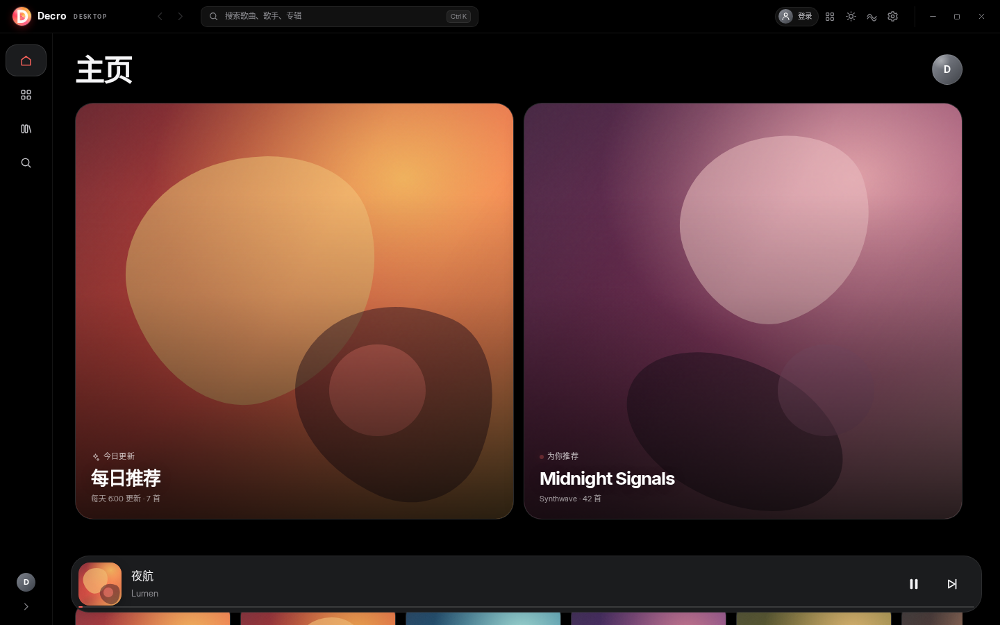
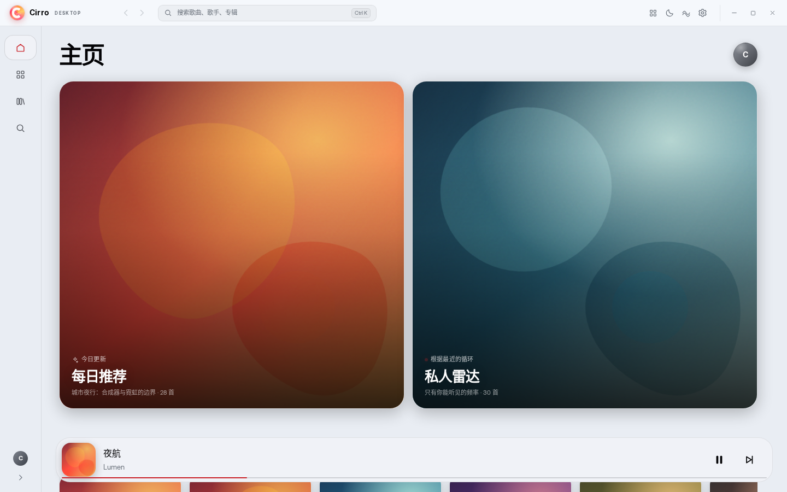
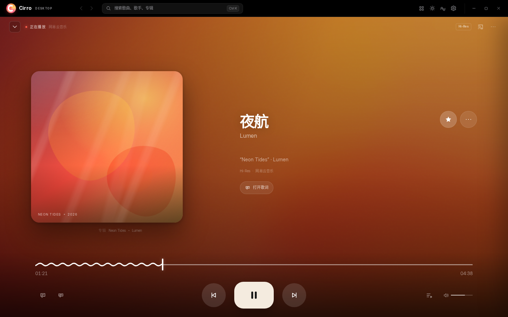
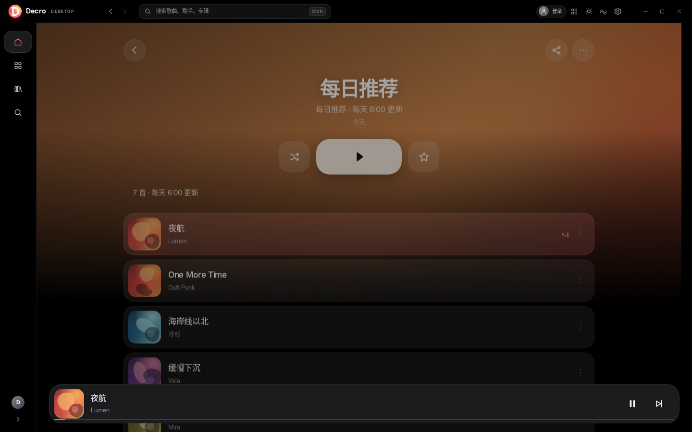
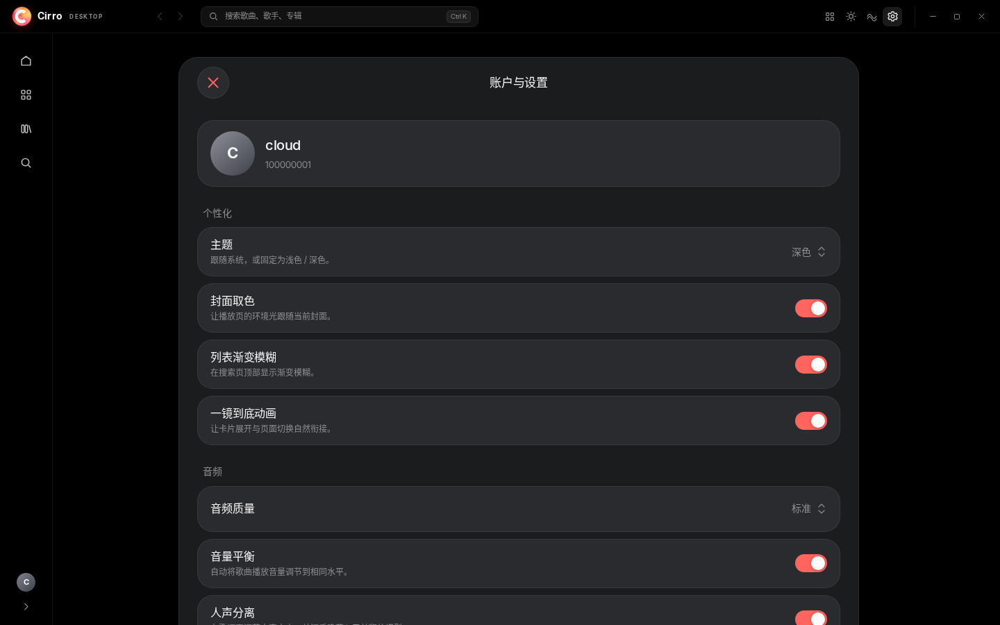

# Decro

> Decro（**De**sktop + **C**irro）是一个面向 Windows 的、非官方的 Cirro 桌面重制版。
> 以 **Cirro 的视觉语言与动效** 为核心，同时提供可用的扫码登录、在线曲库、搜索与播放。

Cirro 原本是一个 Android 音乐播放器，设计上有很强的个人风格：品牌红、流体渐变、玻璃浮层、封面取色、胶囊形 dock、从卡片连续长成全屏播放页的动效，以及逐行/逐字歌词。Decro 把同一套语言搬到桌面，而不是把手机比例放大。项目名称由 desktop 与 Cirro 组合而成，但仍明确标注这是对 Cirro 的非官方重制与致敬。


## 下载

- **Windows 10/11 x64 安装包**：[Decro Desktop 0.4.1 (NSIS .exe)](https://github.com/CLoudXiao778/decro/releases/download/v0.4.1/Decro.Desktop_0.4.1_x64-setup.exe)
- 安装包约 **2.49 MiB**；未签名，首次运行可能触发 SmartScreen 提示。
- 依赖系统 WebView2（Windows 11 自带；较新的 Windows 10 通常已随 Edge 安装）。
- 这是 **0.4.1 版本**：进度条改为单条 SVG 路径在直线与曲线之间形变；保留 0.4.0 的 Windows 媒体控制与迷你播放器移除。

## 当前状态

- **阶段**：0.4.1 · Decro 品牌 + libnetease 登录/播放 + Windows 系统媒体控制
- 已通过无线 ADB 获取 alpha42 真机截图，并按真机界面重做了主页、资料库、搜索、详情、播放页与歌词页。
- 已完成：桌面标题栏、图标侧栏、底部播放条、沉浸播放页、全屏歌词、搜索命令面板、主页/分类/资料库/搜索/详情/设置、亮/暗主题、Splash、共享封面转场、响应式布局。
- **0.4.1 修复**：
  - 播放页进度条不再用波形/直线两个元素做透明度交叉淡入淡出；改为同一个 SVG path 在 500ms 内从曲线形变为直线、再形变回曲线。
  - 波形滚动使用 transform，低性能模式与减少动效设置仍然生效。
- **0.4.0 新增 / 移除**：
  - 接入 Windows SMTC：系统媒体浮层同步歌曲名、歌手、专辑、封面、播放状态和进度；键盘媒体键与系统浮层可播放/暂停、上一首、下一首。
  - 移除未使用的迷你播放器：标题栏入口、迷你窗口、`?mini` 预览和相关样式/截图删除。
- **0.3.2 修复**：
  - 修复点击播放后无声的根因：播放源 effect 误订阅了整首歌曲对象，`loadedmetadata` 更新时长时把同一个音源无限重载，导致 `audio.play()` 每次都被 `AbortError` 中断；实测 17 秒内重载 5688 次。
  - 把音源依赖改为 `id + token` 的 memo，并忽略 `AbortError`；`canplay` 时若仍暂停会自动重试播放。
  - 日志新增可确认的 `audio canplay` / `audio playing` 阶段，继续在 设置 → 实验 → 调试日志 查看。
- **0.3.1 修复 / 诊断**：
  - 修复关闭沉浸播放页后残留大封面/播放层的问题（关闭时封面飞回 dock，结束后强制隐藏播放层与克隆层）。
  - 加入 debug 日志：设置 → 实验 → 调试日志，可打开日志目录；日志覆盖登录、libnetease 请求、音源解析、代理 Range、audio 生命周期与播放拒绝原因。
  - 为 WebView2 加 `--autoplay-policy=no-user-gesture-required`；播放被拦截时会弹出提示，不再静默失败。
- **0.3.0 修复**：
  - 接入 Cirro 原项目的 **libnetease**（C 子模块）处理扫码登录、`os/appver` 音源签名和红心；不再手写网易云加密/播放 URL。
  - 修复 weapi 请求缺少 `Content-Type` 导致网易云返回空 body 的问题；这是之前播放全部失败的根因之一。
  - 保留网页版 Cookie 导入；导入后会同步到 libnetease 的会话 jar。
- **0.2.1 实装**：
  - 项目/应用/安装包/包标识符统一改名为 **Decro**；旧 `cirrodesktop` 登录凭证自动迁移到 `decrodesktop`。
  - 新的 D 字标记与 Decro 品牌文案；设置页和登录页加入对 Cirro 原项目的感谢。
  - 网易云扫码登录（新版 `type=3` 桌面接口），登录态由 Windows DPAPI 加密保存在本机；二维码被风控时支持网页版 Cookie 导入。
  - 在线首页：推荐歌单、新歌速递、每日推荐、最近播放。
  - 资料库：我的歌单、收藏歌单、我喜欢的音乐、最近播放。
  - 搜索：在线歌曲与歌单，结果可直接播放或打开。
  - 播放：Rust 本地音频代理、Range/seek、播放/暂停、上一首/下一首、队列、音量、进度、真实歌词、喜欢/取消喜欢。
- Windows 集成：系统媒体浮层（SMTC）同步歌曲名/歌手/封面/进度，键盘媒体键与系统上一首/下一首可用。
  - 低配自动性能模式（4 线程及以下 CPU 默认开启）、500ms 波形播放/暂停交叉淡入淡出。
- 在线数据来自网易云非官方接口；登录/音源/红心经 `libnetease`，首页/歌单/搜索等仍由 Rust 直连 Web 接口。评论、下载、播客/MV、云盘、听歌上报尚未接入。
- 如果播放仍无声音：打开 设置 → 实验 → 调试日志，把 `decro.log` 发给开发者；日志不包含 Cookie/token。
- 最终目标：Tauri 2 + Rust + libnetease 统一数据层 + 系统 WebView2，安装包控制在 8–12 MB（不含 WebView2）。

### 致谢

- **Cirro 原项目**：[ThripleQ/cirro](https://github.com/ThripleQ/cirro) — 设计语言、交互与动效的源头；Decro 是非官方重制，感谢原作者。
- **libnetease**：[ThripleQ/libnetease](https://github.com/ThripleQ/libnetease) — Cirro 的 C 请求内核，0.3.0 起用于扫码、音源与红心。
- **alpha42 真机截图** — 用于设计研究，仅本地保留，不随仓库发布。
- **Inter / Tauri / SolidJS / 所有开源依赖** — 各自许可证见 `THIRD_PARTY.md` 与锁文件。

### 源版本参考

alpha42 真机截图只保存在本地 `docs/screenshots/apk/`，用于设计研究，**不随公开仓库发布**：它们包含第三方专辑封面、用户收听记录和真实歌词。对应结论已整理进 `docs/apk-analysis.md` 与 `docs/style-audit.md`。

### Decro 桌面截图

| 首页（深色） | 首页（浅色） |
|---|---|
|  |  |

| 沉浸播放 | 歌单详情 |
|---|---|
|  |  |

| Splash | 设置 |
|---|---|
|  |  |

## 为什么是这套技术栈

| 方案 | 预估包体 | 取舍 |
|---|---:|---|
| **Tauri 2 + Rust + SolidJS** | **8–12 MB** | 使用 Windows 自带 WebView2；CSS/WebGL 做动效；Rust 做网络、缓存与系统集成 |
| Electron | 100 MB+ | 包体直接失控 |
| Flutter | 25–35 MB | 动效好，但没有必要为这个 UI 付出额外运行时 |
| Qt 6 QML | 30–45 MB | 原生、无 WebView 依赖，但迭代成本高 |
| Compose Desktop | 60 MB+ | 最接近 Android 源，但 JRE 太大 |

“使用内置的”是硬约束：WebView2、DWM/Mica、SMTC、系统通知、系统字体都直接使用 Windows 自带的，不额外打包 Chromium、Node、JRE 或媒体运行库。

## 快速开始

```bash
npm install
npm run dev
```

打开 <http://127.0.0.1:1420>。加 `?nosplash` 可跳过开屏。

```bash
npm run build       # 类型检查 + 生产构建
npm run preview     # 预览构建产物
npm run screenshots # 生成 docs/screenshots（需先启动 dev server）
npm run tauri dev   # 需要 Rust、WebView2 与 Windows（或 Linux WebKitGTK）
```

## 目录

```text
src/
  components/     # 壳、标题栏、dock、播放页、图标、封面、进度条
  pages/          # 主页 / 分类 / 资料库 / 搜索 / 详情 / 设置
  data/           # 浏览器预览数据
  lib/            # 扫码登录、在线 API 适配、播放配置、时间/插值
  styles/         # tokens / base / app / pages
src-tauri/        # Rust 后端：libnetease 子模块、在线 API、本地音频代理、DPAPI
docs/             # 设计、动效、APK 分析、架构、构建、登录
public/fonts/     # Inter（OFL）
```

## 设计文档

- [docs/apk-analysis.md](docs/apk-analysis.md) — 从 APK 解包得到的结构与设计证据
- [docs/design-system.md](docs/design-system.md) — 颜色、字体、形状、布局、组件
- [docs/motion.md](docs/motion.md) — 动效令牌、Splash、共享封面、播放页展开
- [docs/desktop-adaptation.md](docs/desktop-adaptation.md) — 为什么不是“放大的手机”
- [docs/style-audit.md](docs/style-audit.md) — 与源版本的逐项一致性审计
- [docs/architecture.md](docs/architecture.md) — 当前结构与 Tauri 后端规划
- [docs/auth.md](docs/auth.md) — 扫码登录流程、凭证存储与安全边界
- [docs/build.md](docs/build.md) — Windows 构建、CI、包体预算
- [docs/README.md](docs/README.md) — 文档索引

## 重要说明

- 这是一个**非官方**项目，与 Cirro 原作者无关。
- 上游 Cirro 仓库没有提供 LICENSE；本项目不直接复制其代码、Logo、图标或字体资产。图标为自绘 SVG，字体 Inter 使用 OFL 授权。
- 本仓库的代码以 MIT License 发布；上游的专辑封面、歌词与真机截图不属于本仓库。
- 网易云音乐接口属于第三方非官方接口，登录、曲库与播放的可用性由平台策略决定；风险由使用者自行承担。
- 登录优先使用扫码；若网络被风控，可在登录弹窗内导入网页版 `MUSIC_U` 凭证。应用不绕过验证码、风控或版权限制。
- 登录凭证只保存在本机 `%APPDATA%`，由 Windows DPAPI 加密；前端与日志都拿不到 Cookie。
- 音频通过只监听 `127.0.0.1` 的 Rust 代理播放，代理带随机 token；浏览器/前端不直接接触音源签名 URL。
- 当前没有捆绑任何 ONNX 模型；设置页也已移除人声分离入口。

## License

代码：[MIT](LICENSE)。第三方组件与字体许可见 [THIRD_PARTY.md](THIRD_PARTY.md)。
